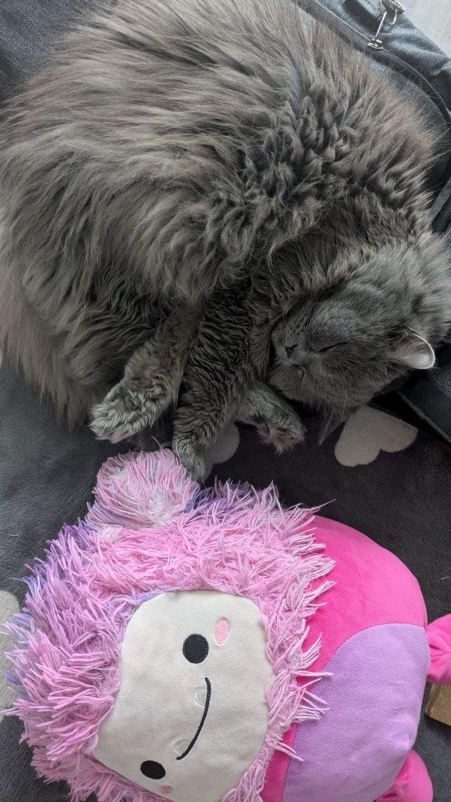

# Daggerfall Forever

A fork of DFO focused on modular single-player experience. The aim is to integrate as much major DFU mods as possible and make their settings customizable.

---

## Vision
To make a single-player, client-based, modular and highly customizable version of DFO with:
* Selected online features playable offline and toggleable in settings (firmament, gathering and crafting, player housing, 24/7 city infrastructure).
* Selected online features disabled (world events, boss raids, shop, armory).
* As much major, significant DFU mods integrated and toggleable, with settings, as possible.

To allow players create their own custom-tailored experience in an easy and simple way. By default. this version will come pre-customized with the focus on immersion - but again, everything is customizable.  

---

## Why this vision
DFO to me is actually still great, but I also don't like the MMOization and monetization focus of it.

Their initial direction (mod integration) was my dream game, but they diverted from it to something I don't enjoy. I still respect the developers and am grateful to them for providing a foundation.

What I highly value is the ease of setting it up for actual play. In DFU I probably spent more time setting up and maintaining my modlist than playing it. Still an amazing experience, thank you Interkarma and modders! You did something legendary!

DFO team solved it by providing an easy to install package that you tweak to your heart's content for half an hour and then just play.

DFO team also, in my point of view, delivered some truly great convenience and gameplay features:
* An auto-updating client with a launcher
* Easy localization
* Tons of settings
* Integration of beloved mods
* Modernized gameplay and controls
* Tamriel
* Nice overworld travel (I'm already tired of it atm, but hey, it's toggleable!)
* Cross-platform architecture
* Optional usage of Morrowind assets

I love Daggerfall. I love DFU more. I love modded DFU the most. But I am tired of maintaining modlists. And I don't need Daggerfall to be an online game. It's fun, but to me not worth the cost.

And hey, I won't need monetization to sustain servers!

I want to make something that will be — to me — an ultimate version of Daggerfall, at least for now. And will share my results with you.

**Daggerfall is Forever. Your game, your rules. Open source, customizable, without any monetization and with — hopefully — beloved mods.**

---

## Open source
Yes. Always.

---

## AI disclosure
Yes. I understand that a lot of people won't like it.

I'm a game developer, both professional and hobbyist. In my indie projects I use AI, but the old way: as a chat bot. Not agentic. I consult how to make this and that, show it the code, and ask to give me updates to my methods. That's my pipeline.

But this is not my codebase and I don't know JavaScript. I mainly work with Unreal Engine, since 2012, so C++. I have a degree in Software Engineering, but to make it happen not in 20 years, yes, I am going to experiment with agentic development: Google Antigravity in this case.

If that doesn't work for me, I'll switch back to my usual pipeline. But AI to me is an enabling tool — I won't be able to deliver my vision without using it in some form.

---

## Monetization
Nope. Never. Not even donations.

---

## Who am I
Name is Alex Uslavtsev, nickname is simply "13". I live in Ukraine, so yes, the war. With its consequences and lack of predictability.

I make my own games during the evenings and weekends, and have a small team as well. We did [Titans of the Past](https://store.steampowered.com/app/3098170/Titans_of_the_Past/) recently.

I also was one of the leaders of a CIS-based project called FOnline — a Fallout 2-based MMO from early 2000s.

Gamedev is my profession, hobby, and passion.

My main background is Game Design and Producing. I took a leadership track and now am working for GSC Game World (S.T.A.L.K.E.R. 2).

*In relation to this project I'm in no way, shape or form affiliated with GSC Game World.*

My favorite games are DFU, Neverwinter Nights by BioWare (R.I.P. my dear), and Tales of Maj'Eyal.

I have a cat named Raccoon:

I love doing stuff much more than talking about it.

---

## Collaboration
My idea is to make a foundation, then switch to collaboration with mod authors in the DFU community (in which I belong for years, but only as a silent reader): ask permission to integrate and consult if needed.

Pull requests are welcome, but tbh I somehow don't have much experience with Git. Was mostly using Perforce and some SVN back in the day. But if you want to help, I'll appreciate it.

---

## What is already done
* Launcher targets this repository.
* Saves are in its own app data folder.

## FAQ

### Are my DFO saves safe?
Yes! This version has its own save folder. Your DFO offline saves and, obviously, online progress are safe. You can play both versions at the same time.

### Is it still an MMO?
No.

### Is it still multiplayer at all?
At this moment, no. Only offline, single-player experience.

I do not plan to support a persistent world, but will look into co-op / local servers after the single-player experience is stable. Probably by the end of 2027.

### Monetization?
No.

### Discord?
I plan to set up something very simple in Nov 2026.

---

## Roadmap

Oh folks, I'm a gamedev producer, I know roadmaps shift. So this is a living one, with preliminary and rough estimations on when I'll deliver things. Things **WILL** change. But the focus won't.

* **Firmament offline** — done
* **Player housing like in online (toggleable)** — Nov 2026
* **Make fast travel first-person by default (toggleable)** — Nov 2026
* **Add emergent city quests and more wilderness encounters (if mod authors allow)** — Dec 2026
* **Make gathering and crafting playable offline (toggleable)** — Jan 2027 *(heavy feature)*
* **Family without Project Legacy** — Feb 2027
* **Challengers (own system)** — Apr 2027  
  Encounters with NPC heroes that have heard about your deeds and want to challenge you. Like Revenants, they have perks and traits. Depending on your skills and stats, outcomes of meetings might differ (peaceful, combat, fleeing, etc.).
* **Continuous polishing & mod integration** *(with authors' consent, toggleable via settings)*
